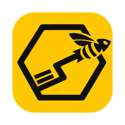
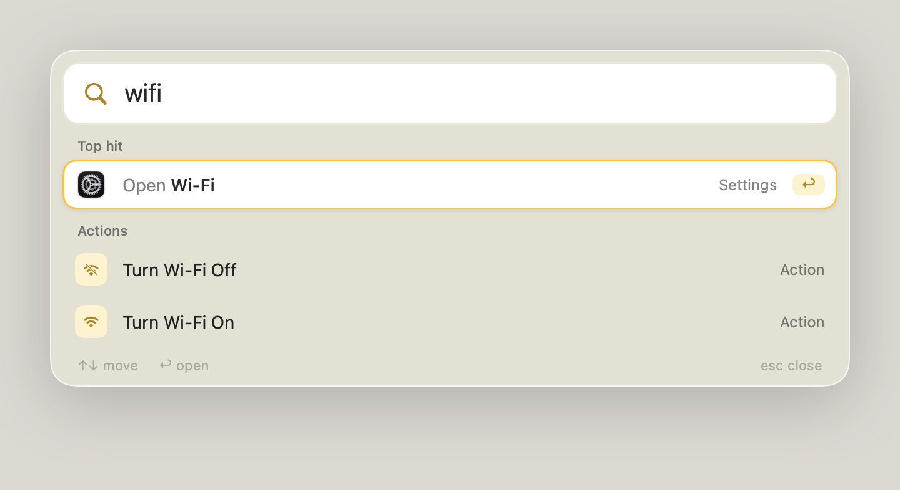
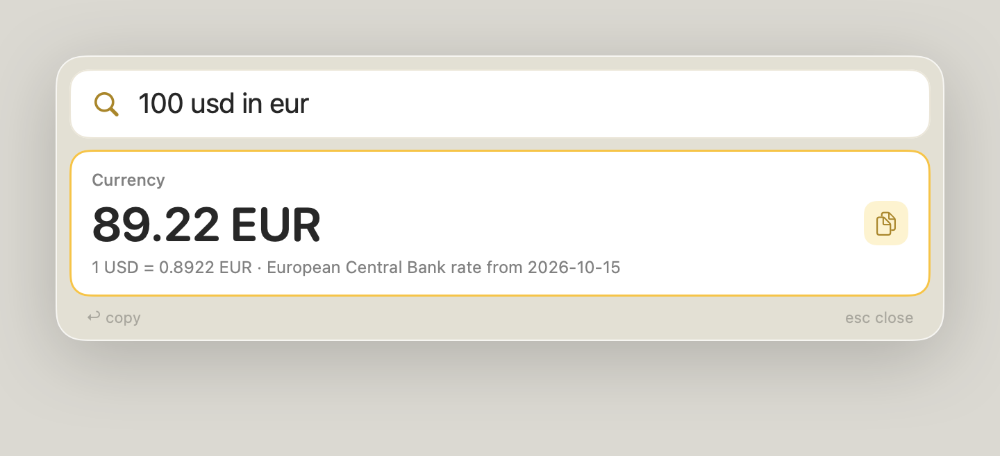
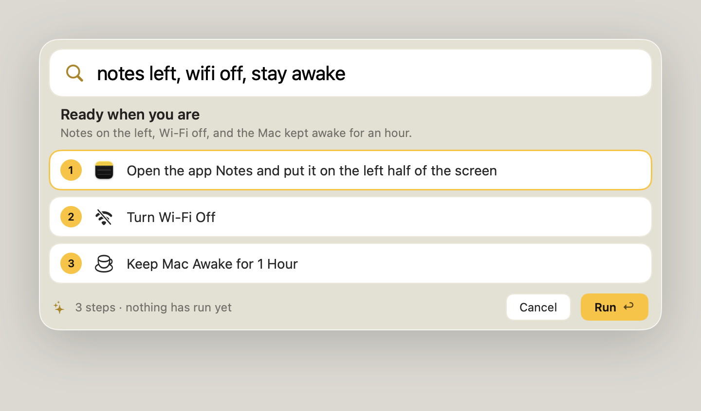

<p align="center"></p>

<h1 align="center">Beeline</h1>

<p align="center"><b>Beeline to anything.</b><br>
A fast Spotlight replacement for Mac that infers commands from plain text.</p>

<p align="center"></p>

## What it does

- Opens apps, files, browser tabs and windows
- Opens System Settings pages from everyday words, like "night shift"
- Runs menu commands and presses buttons in the app in front
- Sleeps, locks, mutes, switches dark mode and Wi-Fi, quits apps
- Moves the front window to half or full screen
- Closes browser tabs that match what you type
- Does sums, and converts units, currencies and time zones
- Adds reminders and goals to Reminders
- Saves your open apps, windows and tabs, and brings them back later
- Copies, moves and installs files from the Finder window, like "packet logger to applications"
- Compresses, renames and converts the files selected in Finder, combines PDFs, and shrinks images and videos
- Rewrites the text selected in any app, like "make this shorter" or "translate to spanish"
- Keeps a history of what you copied
- Listens when you hold ⌘Space
- Asks Claude to answer questions or plan multi-step requests, which you approve first
- Learns what you pick and puts it first

<p align="center">
  
  
</p>

## Install

Needs an Apple silicon Mac on macOS 14 or later, with the Xcode Command Line Tools (`xcode-select --install`).

```sh
git clone https://github.com/ScribleSean/beeline
cd beeline
bash scripts/build-app.sh && open build/Beeline.app
```

To open it with ⌘Space, turn off Spotlight's shortcut in System Settings › Keyboard › Keyboard Shortcuts. Ask Claude needs [Claude Code](https://claude.com/claude-code) signed in. **Update Beeline** in the menu bar keeps it current.

## Privacy

Beeline runs on your Mac. It goes online only for:

- **Currency rates,** from the European Central Bank through [Frankfurter](https://frankfurter.dev), twice a day. Nothing about you is sent.
- **Ask Claude,** when you choose it. Your request goes to Claude, and for a plan, so do the names of your open windows and tabs.
- **Search the web,** when you choose it, in your browser.

Clipboard history stays in memory and ends when Beeline quits. Anything a password manager marks as private is never kept. What you pick is remembered in `~/Library/Application Support/Beeline`, and Settings can clear it.

## Permissions

macOS asks the first time a feature needs one.

| Permission | For |
| --- | --- |
| Accessibility | Windows, menu commands, buttons, pasting |
| Automation | Browser tabs, dark mode, emptying the Trash |
| Reminders | Reminders and goals |
| Microphone and Speech Recognition | Holding ⌘Space to talk |

## Keys

| Key | Does |
| --- | --- |
| ⌘Space | Open or close |
| Hold ⌘Space | Talk |
| ↑ ↓ | Move |
| ↩ | Open, run or copy |
| esc | Back, then close |

Anything that can't be undone, like emptying the Trash, asks for a second ↩.

## Development

Everything is in `Sources/Beeline`. These check behaviour without opening the bar:

```sh
build/Beeline.app/Contents/MacOS/Beeline --query "night shift"       # ranked results
build/Beeline.app/Contents/MacOS/Beeline --ai "make my mac quieter"  # the on-device model's pick
build/Beeline.app/Contents/MacOS/Beeline --plan "mute and dark mode"  # Claude's plan, runs nothing
build/Beeline.app/Contents/MacOS/Beeline --preview "wifi" bar.png    # render the bar to an image
build/Beeline.app/Contents/MacOS/Beeline --rewrite "more formal" "hey u free?"  # a rewrite, replaces nothing
```

The build signs ad hoc, so macOS may ask for permissions again after each rebuild. Set `BEELINE_SIGNING_IDENTITY` to a code-signing certificate's fingerprint to keep them.

## License

[MIT](LICENSE)
