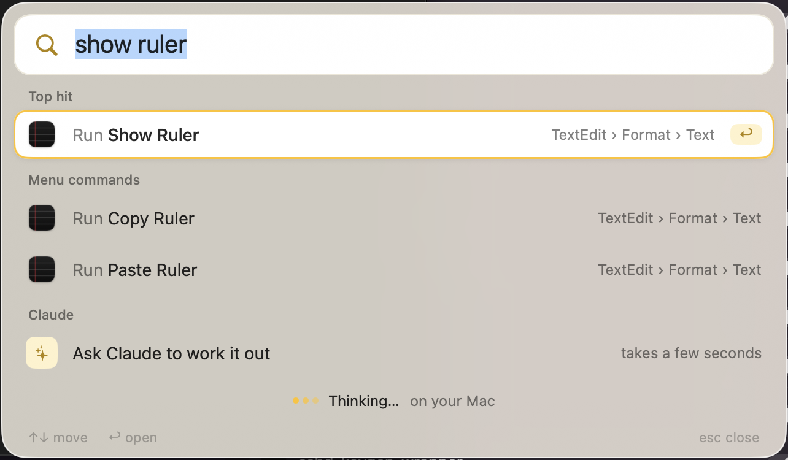
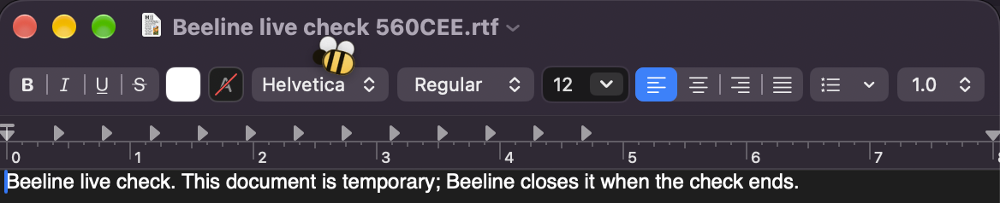
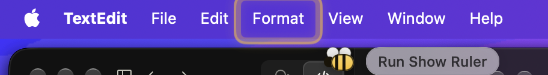

<p align="center"></p>

<h1 align="center">Beeline</h1>

<p align="center"><b>Type, or hold ⌘Space and talk. A bee shows where Beeline acts.</b><br>
A Mac assistant that finds the app, setting, window or command you mean and runs it.</p>

<p align="center"></p>

## What it does

- Opens apps, files, browser tabs, windows, and System Settings pages from everyday words like "night shift".
- Runs menu commands and presses buttons in the app in front, like "show ruler" in TextEdit.
- Controls the Mac: sleep, lock, mute, dark mode, Wi-Fi, quitting apps, and moving the front window to half or full screen.
- Works out sums and converts units, currencies and time zones in the bar.
- Handles chores: reminders and goals, saved desktops of apps, windows and tabs, file moves and copies from Finder, compressing, renaming, converting and shrinking files, and rewriting selected text in any app.
- Listens while you hold ⌘Space, and your words fill the bar as you talk. If you name an app, a setting or a window plainly, it opens when you let go unless you press esc.
- Runs the shortcuts you built in the Shortcuts app, by name.
- Undoes the last toggle, window move, or file copy or move when you type "undo", including a file it replaced.
- Asks Claude to answer a question or plan a multi-step request. You see the plan and approve it before anything runs.
- Learns what you pick for a phrase and puts it first next time, marked "learned". ⇧⌘⌫ forgets a pick, and a pick you don't use for four weeks stops counting.
- Makes aliases: type a few letters, select a result and press ⇧⌘A, and those letters open it from then on.

<p align="center">
  
  
</p>

## The bee

When Beeline is about to press something on screen, a small bee flies there first, a yellow ring settles on the target, and a label says what it is about to do. Then it acts. Your own pointer doesn't move.

<p align="center"></p>
<p align="center"></p>
<p align="center"></p>

A run stops or skips its target in three cases:

- **Escape, in any app,** stops it. Beeline watches for Escape without blocking it, so the key still reaches the app in front.
- **Your own click or keypress** stops it too. Moving the pointer doesn't.
- **If the window changed** while the bee was on its way, Beeline presses nothing. It checks the target again when the bee lands.

The bee goes only to things with a place on screen: buttons, fields, menu commands and windows. Apps and settings open at once, without the bee. You can turn the bee off in Settings. With Reduce Motion on, it appears in place instead of flying.

## How it works

- **Matching happens on your Mac.** Beeline reads your apps, settings, windows and tabs, plus the front app's menus and buttons through Accessibility, and ranks them against what you type. The on-device language model rewrites loose requests into search words.
- **Speech recognition runs on your Mac,** in your Mac's language when it can, with your app names as hints. Without on-device recognition, Beeline doesn't listen at all.
- **Letting go acts only when it's plain and safe.** If your words name one app, setting, window or toggle exactly (or your alias for it), Beeline shows what it will run, then runs it 0.7 seconds later, or 3 seconds or more with VoiceOver on. Press esc in that time to stop it. Anything that sends, deletes, closes, quits or runs a Shortcut waits for ↩. "Act when you let go" in Settings turns this off.
- **Claude picks only from a list.** For a plan, Claude sees numbered options built from what is on your Mac and replies with option numbers. It has no tools and cannot run anything. You see every step before you press Run.
- **Anything that can't be undone needs ↩ twice:** emptying the Trash, restarting, shutting down, logging out, ejecting disks, closing several tabs, replacing a file, and buttons or menu commands like Delete, Send, Don't Save, Close All Tabs, or OK in a dialog.

## Install

Beeline needs an Apple silicon Mac on macOS 14 or later, with the Xcode Command Line Tools (`xcode-select --install`).

```sh
git clone https://github.com/ScribleSean/beeline
cd beeline
bash scripts/build-app.sh && open build/Beeline.app
```

The welcome screen shows you how to allow Accessibility. **Update Beeline** in the menu bar pulls the newest version and rebuilds it. Ask Claude needs [Claude Code](https://claude.com/claude-code) signed in on the same Mac. Beeline runs only a `claude` that Anthropic signed, so an npm install won't work. Use the native installer.

### ⌘Space and Spotlight

Spotlight uses ⌘Space until you turn its shortcut off in System Settings › Keyboard › Keyboard Shortcuts › Spotlight. Until then, Beeline opens with ⌥Space and says so. The welcome screen names what holds ⌘Space (Spotlight, input-source switching or another app) and has a button that opens Keyboard settings. You can choose ⌘, ⌥ or ⌃Space in Settings.

## Permissions

macOS asks for each permission the first time a feature needs it. Beeline doesn't need Input Monitoring or Screen Recording.

| Permission | Why |
| --- | --- |
| Accessibility | To read windows, menus and buttons in other apps and press them, paste, lock the screen, and watch for Escape while the bee works |
| Automation | To read and switch browser tabs, switch dark mode, read Finder's selection, and empty the Trash |
| Files & Folders | For file chores on the Desktop, Documents and Downloads |
| Reminders | To add reminders and goals |
| Microphone and Speech Recognition | To hear you while you hold ⌘Space |

Without Accessibility, Lock Screen and paste say so instead of doing nothing. Restart, Shut Down, Log Out and Eject need no permission.

## Privacy

Beeline runs on your Mac. It goes online only for:

- **Currency rates,** from the European Central Bank through [Frankfurter](https://frankfurter.dev), when the saved rates are more than 12 hours old. Beeline sends nothing about you.
- **Ask Claude,** when you choose it. Your request goes to Claude. For a plan, Beeline also sends the options it builds the plan from: the names of your running apps, open windows and tabs, the front app's menu commands (except those under Open Recent, History, Bookmarks, Recent Items, Reading List and Recently Closed) and the labels of buttons and links in the front window. Those labels can include names and file names in apps like Mail or Slack.
- **Search the web,** when you choose it, in your browser.

Clipboard history stays in memory and ends when Beeline quits. Beeline doesn't keep anything a password manager marks as private.

Beeline saves what you pick, with the words you typed to find it, in `~/Library/Application Support/Beeline`, so it ranks first next time. It doesn't record reminders, web searches, desktops or file chores. **Forget picks** in Settings clears it. Saved desktops (app, window and tab names) and aliases are in the same folder.

## Keys

| Key | Does |
| --- | --- |
| ⌘Space | Open or close |
| Hold ⌘Space | Talk |
| ↑ ↓ | Move |
| ↩ | Open, run or copy |
| esc | Back, then close |
| esc, in any app | Stop what the bee is doing |
| esc, while holding ⌘Space | Throw away what you said |
| ⌘K | Actions for the selected result |
| ⇧⌘C | Copy its path, link or name |
| ⌘↩ | Show an app or file in Finder |
| ⇧⌘A | Make what you typed an alias for the selected result |
| ⇧⌘⌫ | Forget a learned pick or remove an alias |

## Development

The app's code is in `Sources/Beeline`. Run the tests with `swift test`. These flags check behaviour without opening the bar:

```sh
build/Beeline.app/Contents/MacOS/Beeline --query "night shift"       # ranked results
build/Beeline.app/Contents/MacOS/Beeline --ai "make my mac quieter"  # the on-device model's pick
build/Beeline.app/Contents/MacOS/Beeline --plan "mute and dark mode"  # Claude's plan, runs nothing
build/Beeline.app/Contents/MacOS/Beeline --preview "wifi" bar.png    # render the bar to an image
build/Beeline.app/Contents/MacOS/Beeline --rewrite "more formal" "hey u free?"  # a rewrite, replaces nothing
```

`bash scripts/live-check.sh` runs Beeline on a real screen and reports pass or fail for each scenario: `press`, `plan`, `escape`, `click`, `welcome`, `release`, `open`, `rewrite`, `tab` and `permissions`. Pass scenario names to run only those. Beeline opens and closes its own throwaway TextEdit document, and for `tab` its own Safari window. Safari must already be open. `rewrite` asks Claude, so it needs Claude Code signed in. `permissions` checks that a signed build still gets real mic audio, speech, Reminders, Accessibility and Automation. The script needs Beeline at `~/Applications/Beeline.app` (or the path in `BEELINE_APP`) with Accessibility, and Screen Recording for the terminal, for the screenshots. Keep your hands off the keyboard and mouse while it runs, because a click or a key stops a run.

`swift scripts/make-icon.swift` rebuilds the app icon and the menu bar glyph from `Resources/AppIcon-source.png`. Set `ICON_PREVIEW=/path/to/preview.png` to also write a 512-pixel preview of the icon.

Each ad hoc build is a new app to macOS, so its permissions stop working after a rebuild even though System Settings still shows Beeline switched on. To fix it, remove Beeline from the list with − and add it again. To keep permissions across rebuilds, put a code-signing certificate's name or fingerprint in an untracked `.signing-identity` file at the repository root (git worktrees use the main checkout's). `BEELINE_SIGNING_IDENTITY` works too, but only for builds started from a shell that sets it. **Update Beeline** doesn't see variables from `~/.zshrc`. The build prints a warning when it signs ad hoc.

The build script signs with hardened runtime, so other code can't load into Beeline (for example through `DYLD_INSERT_LIBRARIES`) and use its permissions. `Resources/Beeline.entitlements` turns back on what hardened runtime blocks and Beeline uses: the microphone, Apple Events and Reminders. A new feature that needs another protected resource (camera, contacts, location) needs its entitlement there too, or it fails silently.

To test voice without a microphone, build the app and run:

```sh
bash scripts/voice-check.sh "open TextEdit"
bash scripts/voice-check.sh "open TextEdit" --run
bash scripts/voice-check.sh "open TextEdit" --installed
```

The script uses `build/Beeline.app` by default. `--installed` uses `~/Applications/Beeline.app`, and `--app /path/Beeline.app` uses another copy. The script makes an AIFF recording with `say`, opens the bar as if you held the shortcut, feeds the recording through the same recognition sessions as the microphone, and lets go at the end. It prints the transcript, the chosen action and the result, and exits nonzero on failure. It also leaves a JSONL log with the partial and final text, the engine, the action and the accessibility announcements. Actions run only with `--run` (or `BEELINE_VOICE_RUN=1`). The check covers recognition and selection. With `--run`, a pass means Beeline dispatched the action, not that the target app changed.

Beeline reads voice from a file only when both `BEELINE_DEMO=voice` and `BEELINE_VOICE_FILE=/path/to/audio` are set. It uses an installed macOS 26 dictation model when there is one, and the on-device recognizer otherwise. It doesn't download a model or ask for microphone permission. The recognizer needs Speech Recognition permission that you already granted. If the permission or the model is missing, the check fails and says why. The `swift test` file tests need no permissions and don't show windows.

## Contributing

Issues and pull requests are welcome. Before you open a pull request, run `swift build` and `swift test`, and add a test for any behaviour you change. Keep changes small and focused.

## License

[MIT](LICENSE)
